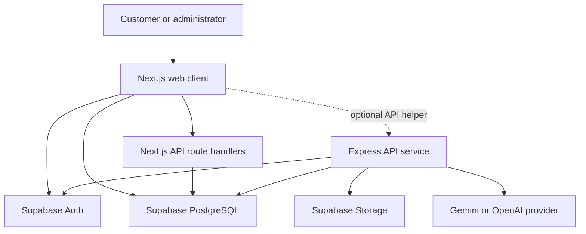
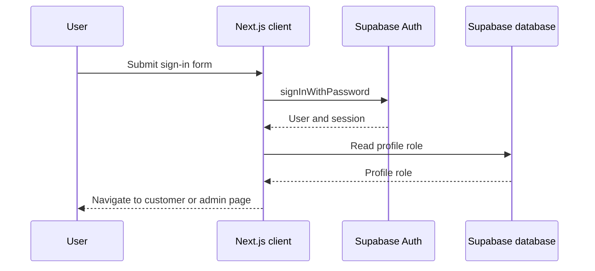
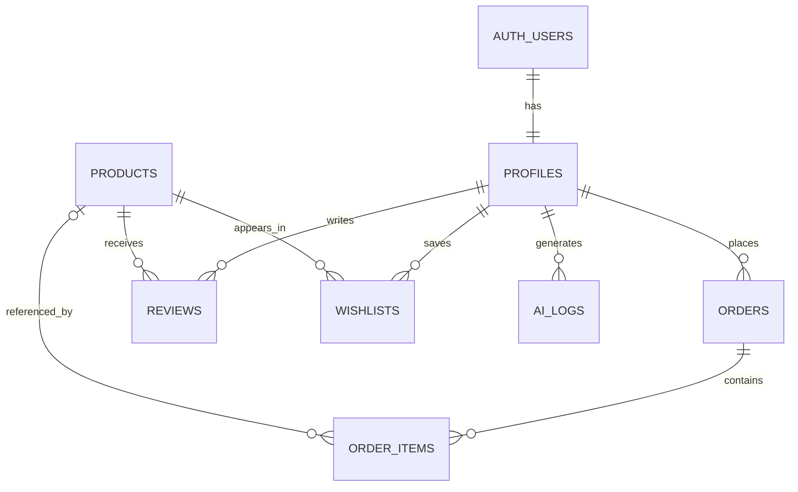

# Green Nest

AI-assisted plant discovery and e-commerce application. This repository contains a Next.js web client, a separate Express API service, and Supabase database/storage setup scripts.

> **Implementation note:** This README describes the source code and configuration present in the repository's `main` branch. A feature described in a requirement document is not automatically a completed feature. Production behavior, live database state, external provider settings, and deployment configuration are marked **Not verified** where source inspection cannot prove them.

## 1. Project overview

Green Nest is designed to help users browse plants, manage a shopping experience, and receive AI-assisted plant suggestions. It also includes an administration interface for catalog, order, customer, and AI activity management.

- Repository: [kethana009/Green-Nest](https://github.com/kethana009/Green-Nest)
- Web client: Next.js App Router application in `client/`
- API service: Express application in `server/`
- Database and storage setup: SQL scripts in `supabase/migrations/`
- Product and development documentation: `PRD.md`, `design.md`, `Development Phases/`, and `project requirement document/`

## 2. Project status and scope

The repository contains implementation for customer-facing pages, admin pages, Next.js route handlers, Express routes, Supabase clients, and SQL schema/policies. This README separates code presence from verified end-to-end operation.

| Area | Repository evidence | Status |
|---|---|---|
| Web application | Next.js pages and shared components | Implemented in source; runtime not independently tested |
| Supabase authentication | Browser Supabase client and login page | Implemented in source; provider configuration not verified |
| Product catalog | Catalog pages, product data helpers, Express product routes | Implemented in source; integration path varies by module |
| Cart and wishlist | React context providers and pages | Implemented in source |
| Checkout and orders | Checkout page and order handlers | Partially implemented; see known gaps |
| Plant Match AI | AI pages/components and Express AI route/service | Partially implemented; provider keys and live behavior not verified |
| Admin tools | Admin page and admin API handlers/routes | Implemented in source; authorization/configuration require deployment verification |
| Payment processing | Cash on Delivery flow in checkout | COD selection present; online payment gateway not configured in inspected source |
| Automated tests | No test script found in inspected package manifests | Not configured / not verified |

## 3. Technology stack

### Frontend
- Next.js 16.2.9
- React 19.2.4
- TypeScript
- Tailwind CSS 4
- shadcn-related UI components and Base UI
- Framer Motion
- Recharts
- React Hook Form and Zod
- Lucide React

### Backend
- Node.js
- Express 4
- TypeScript
- Supabase JavaScript client
- Helmet, CORS, Morgan, Multer
- Google Generative AI SDK
- OpenAI SDK

### Data and infrastructure
- Supabase PostgreSQL
- Supabase Auth
- Supabase Storage
- Vercel deployment is referenced in project context and source conventions; the repository's exact production project settings are **Not verified**.

## 4. Repository layout

```text
Green-Nest/
├── .env.example
├── package.json
├── package-lock.json
├── PRD.md
├── design.md
├── Development Phases/
├── project requirement document/
├── client/
│   ├── package.json
│   ├── next.config.ts
│   ├── public/
│   └── src/
│       ├── app/
│       │   ├── api/
│       │   ├── admin/
│       │   ├── ai-plant-match/
│       │   ├── browse/
│       │   ├── cart/
│       │   ├── chatbot/
│       │   ├── checkout/
│       │   ├── home/
│       │   ├── login/
│       │   ├── orders/
│       │   ├── product/
│       │   ├── profile/
│       │   └── wishlist/
│       ├── components/
│       ├── context/
│       ├── hooks/
│       ├── lib/
│       └── types/
├── server/
│   └── src/
│       ├── config/
│       ├── controllers/
│       ├── middleware/
│       ├── routes/
│       ├── services/
│       └── types/
└── supabase/
    └── migrations/
```

Generated folders such as `node_modules`, `.next`, `.git`, build output, and caches are not part of the documented source layout.

## 5. Architecture

The repository contains two application layers that can communicate with Supabase:

1. The Next.js client uses a browser Supabase singleton for authentication and direct data access. It also contains Next.js route handlers under `client/src/app/api/`.
2. The Express service creates a server-side Supabase client using the service-role credential and exposes a separate REST API under `/api`.
3. Supabase provides PostgreSQL tables, authentication, row-level security policies, and Storage buckets described by SQL scripts.

The existence of both Next.js route handlers and Express routes means not every feature necessarily uses the Express service. Actual production routing between the web deployment and the standalone Express service is **Not verified**.

## 6. High-level architecture diagram



The diagram shows integration points found in source. The optional client-to-Express connection is not confirmed as the active production path for every page.

## 7. Application workflows

### 7.1 Authentication workflow

The login page calls Supabase Auth `signInWithPassword`. Account creation calls `signUp` with profile metadata and then attempts a profile upsert and sign-in. The `useAuth` hook reads the current session, listens for auth state changes, and loads the matching profile.



The signup page includes a customer/admin role selector. Whether the database trigger, profile policies, and client upsert work together in a deployed project depends on the deployed SQL and RLS configuration; this is **Not verified**. Public signup should not be treated as a secure way to grant administrator privileges.

### 7.2 Catalog workflow

The web application includes browse, category, product detail, and home pages. Product records are also represented in `client/src/lib/products.ts`. The Express product routes implement filtering, pagination, single-product lookup, and admin-only create/update/delete operations.

### 7.3 Cart and checkout workflow

Cart state is provided through a React context. The checkout page obtains the signed-in user, loads a selected or saved address from browser local storage, displays the cart, and submits an order request to the Next.js `/api/order/create` handler. The inspected handler writes an order and order items using a server-side Supabase client.

**Important:** The current Next.js order handler in the inspected `main` source accepts client-provided user ID, prices, and quantities. Do not consider this handler production-secure until server-side user-token verification, price lookup, stock validation, and total calculation are enforced. The Express order route contains a different server-side price/stock validation flow, but it is not established that the checkout page uses that Express route.

### 7.4 Plant Match AI workflow

The Express `POST /api/ai/match` route requires authentication and an uploaded image, applies a daily per-user limit, stores the image in Supabase Storage, calls Gemini with an OpenAI fallback, matches products by detected environment, and writes an AI log. The route also exposes AI history and admin logs endpoints.

A separate browser component, `client/src/components/AIPlantMatcher.jsx`, calls the Gemini API directly when `NEXT_PUBLIC_GEMINI_KEY` is set; otherwise it displays demo text. A browser-exposed AI key is not a suitable way to protect a paid provider credential. Prefer a server-side integration before production use.

### 7.5 Administration workflow

The repository includes an admin page and Next.js admin data/action handlers. The Express service separately exposes admin statistics, orders, customer, and AI-log routes guarded by authentication and an admin role check. The actual set of screens and actions available in a deployed environment should be verified against the current database role and configuration.

## 8. Frontend routes

The following page files were found in `client/src/app`:

| Page path | Purpose inferred from source path |
|---|---|
| `/` | Landing/entry page |
| `/home` | Home page |
| `/login` | Sign in and account creation |
| `/browse` | Product browsing |
| `/category` | Category view |
| `/product/[id]` | Product details |
| `/cart` | Shopping cart |
| `/cart/address` | Saved delivery addresses |
| `/cart/address/add` | Add address |
| `/checkout` | Checkout |
| `/orders` | Customer orders |
| `/profile` | Customer profile |
| `/wishlist` | Wishlist |
| `/ai-plant-match` | AI plant matching |
| `/chatbot` | Chatbot interface |
| `/admin` | Admin dashboard |
| `/dashboard` | Dashboard page |

Page-file presence does not guarantee all linked actions or workflows are fully functional.

## 9. Next.js API endpoints

These route handlers were found under `client/src/app/api`:

| Method | Path | Source responsibility |
|---|---|---|
| POST | `/api/order/create` | Creates an order and order items |
| GET | `/api/admin/data` | Returns admin dashboard data after token and role checks |
| POST | `/api/admin/action` | Handles selected admin actions |
| POST | `/api/ai-generate` | AI generation handler |
| GET | `/api/proxy-image` | Fetches a remote image through a server route |

Request validation and security should be reviewed before treating these endpoints as production-ready. The order route has the client-trust limitations described in the checkout section.

## 10. Express API endpoints

The Express app mounts routers at `/api/auth`, `/api/products`, `/api/orders`, `/api/ai`, and `/api/admin`, and provides `GET /health`.

### Authentication
| Method | Path | Access |
|---|---|---|
| GET | `/api/auth/me` | Authenticated |
| PUT | `/api/auth/profile` | Authenticated |

### Products
| Method | Path | Access |
|---|---|---|
| GET | `/api/products` | Public |
| GET | `/api/products/:id` | Public |
| POST | `/api/products` | Admin |
| PUT | `/api/products/:id` | Admin |
| DELETE | `/api/products/:id` | Admin |

### Orders
| Method | Path | Access |
|---|---|---|
| POST | `/api/orders` | Authenticated |
| GET | `/api/orders/my-orders` | Authenticated |
| GET | `/api/orders/:id` | Authenticated; scoped to current user |

### AI
| Method | Path | Access |
|---|---|---|
| POST | `/api/ai/match` | Authenticated; image upload |
| GET | `/api/ai/history` | Authenticated |
| GET | `/api/ai/logs` | Admin |

### Administration
| Method | Path | Access |
|---|---|---|
| GET | `/api/admin/stats` | Admin |
| GET | `/api/admin/orders` | Admin |
| PUT | `/api/admin/orders/:id/status` | Admin |
| GET | `/api/admin/customers` | Admin |
| GET | `/api/admin/customers/:id` | Admin |
| PUT | `/api/admin/customers/:id/rate-limit` | Admin |

All Express route paths above are relative to the Express server origin. A production base URL is **Not verified**.

## 11. Database model

The SQL schema defines the following public tables:

| Table | Purpose |
|---|---|
| `profiles` | User profile, role, addresses, cart and AI usage counters |
| `products` | Plant catalog, pricing, stock and care attributes |
| `reviews` | Product reviews |
| `wishlists` | User-to-product saved items |
| `orders` | Order totals, payment/order status and shipping address |
| `order_items` | Order line items and product snapshots |
| `ai_logs` | Uploaded image reference, AI analysis and recommendations |

The schema also defines a new-user profile trigger, row-level security policies, and a `get_monthly_revenue()` SQL function.

## 12. Database relationship diagram



Relationships are based on foreign keys in `supabase/migrations/schema.sql`. The product snapshot in an order item preserves item details even if the product reference is later removed.

## 13. Supabase migrations and storage

SQL files found:
- `supabase/migrations/schema.sql`: tables, constraints, trigger, RLS policies, and revenue function.
- `supabase/migrations/02_storage_bucket.sql`: storage bucket/policy setup.

Run SQL only against the intended Supabase project after reviewing it. Whether these scripts have already been applied to the deployed project is **Not verified**.

The Express AI route references a Storage bucket named `ai-uploads`. Confirm that the bucket exists and its policies match the intended access model before enabling the feature.

## 14. Environment variables

The repository's root `.env.example` contains the following names. Values must be supplied privately; never commit real credentials.

| Variable | Used for | Required status in source |
|---|---|---|
| `NEXT_PUBLIC_SUPABASE_URL` | Supabase project URL | Required by client/server Supabase setup |
| `NEXT_PUBLIC_SUPABASE_ANON_KEY` | Public Supabase browser/server client key | Required by client/server Supabase setup |
| `SUPABASE_SERVICE_ROLE_KEY` | Privileged server-side Supabase access | Required by Express Supabase configuration and Next.js privileged handlers |
| `SERVER_PORT` | Express port | Optional; defaults to 4000 |
| `JWT_SECRET` | Backend configuration value | Required by `server/src/config/env.ts`; direct usage elsewhere not verified |
| `GOOGLE_GEMINI_API_KEY` | Gemini provider | Optional in configuration; required to execute Gemini AI analysis |
| `OPENAI_API_KEY` | OpenAI fallback provider | Optional in configuration; required for fallback analysis |
| `NEXT_PUBLIC_APP_URL` | Express CORS allowed origin | Optional; defaults to localhost:3000 |
| `NEXT_PUBLIC_API_URL` | Base URL used by client API helper | Optional; defaults to localhost:4000 |

The source component `client/src/components/AIPlantMatcher.jsx` also reads `NEXT_PUBLIC_GEMINI_KEY`, which is **not listed** in the root `.env.example`. This is a separate browser-side key path and should not be confused with the server-side `GOOGLE_GEMINI_API_KEY`.

### Environment file placement

- Root `.env.example` documents the variables but is not itself a runtime environment file.
- The Next.js client reads `NEXT_PUBLIC_*` variables at build time.
- The Express server loads environment variables through dotenv.
- A separate `server/.env.example` was not found.
- Actual local or hosted environment values are not included in this README.

## 15. Prerequisites

- Node.js and npm compatible with the installed Next.js version.
- A Supabase project with the schema and required policies applied.
- Supabase public URL and public client key.
- A Supabase service-role key for server-side privileged operations.
- Optional Gemini/OpenAI credentials for server-side AI functionality.

Exact supported Node.js version is **Not specified** in the inspected manifests. Use a current Node.js LTS release compatible with Next.js 16 and verify locally.

## 16. Installation

From the repository root:

```bash
npm install
```

The root package uses npm workspaces for `client` and `server`. A root `package-lock.json` is present.

## 17. Local environment setup

1. Copy `.env.example` to a private root `.env` file if using the root workspace configuration.
2. Fill in the Supabase and server values required by the code.
3. Configure client-visible `NEXT_PUBLIC_*` values in the environment used to build the Next.js client.
4. Add AI provider credentials only if enabling the corresponding AI path.
5. Do not commit `.env`, `.env.local`, or real credentials.

The exact local env-file loading behavior for every Next.js command is **Not verified**. Next.js normally loads supported env files from its application root; confirm the actual client workspace setup before relying on a root-level file.

## 18. Run the web client

From the repository root:

```bash
npm run dev:client
```

Or from the client directory:

```bash
cd client
npm run dev
```

The client dev script runs Next.js on host `0.0.0.0`. Next.js normally serves the development site at `http://localhost:3000`.

## 19. Run the Express API

From the repository root:

```bash
npm run dev:server
```

Or from the server directory:

```bash
cd server
npm run dev
```

The server script uses `ts-node-dev` to run `src/index.ts`. The configured default port is `4000`; the health endpoint is `GET /health`.

## 20. Run both services

From the repository root:

```bash
npm run dev
```

The root script uses `concurrently` to start the client and server workspace dev scripts.

## 21. Build commands

From the repository root:

```bash
npm run build:client
npm run build:server
```

The client build runs `next build`. The server build runs `tsc`.

A successful build has not been independently executed as part of this documentation task; build status is **Not verified**.

## 22. Start the built Express server

After building the server:

```bash
cd server
npm start
```

The server package defines `start` as `node dist/index.js`. The TypeScript output directory is not explicitly set in the inspected `server/tsconfig.json`; confirm the generated output path before relying on this command in a deployment pipeline.

The client package also defines `npm start` as `next start` after a successful production build.

## 23. Linting and tests

The client package defines:

```bash
npm run lint --workspace=client
```

No test script or test suite was found in the inspected package manifests and source tree. Automated test coverage is **Not configured / Not verified**.

## 24. Authentication and authorization

- Browser sign-in uses Supabase email/password authentication.
- Account creation uses Supabase Auth signup.
- The profile schema includes a `role` value constrained to `customer` or `admin`.
- Express protected routes validate a Bearer token through Supabase Auth.
- Express admin routes apply a role guard.
- Next.js admin handlers also validate the bearer token and profile role.

**Security note:** The signup form currently includes a role selector and passes the selected role in user metadata/profile upsert. The SQL signup trigger assigns the initial role as `customer`. Review signup/profile policies and ensure users cannot promote themselves to admin. Administrator provisioning should be performed through a trusted server-side process.

## 25. AI integrations

The Express AI service implements:
- Gemini image analysis as the primary provider.
- OpenAI image analysis as a fallback.
- JSON-structured environmental analysis.
- Product matching by detected environment and stock availability.
- Per-user daily usage limit.
- AI run history and admin log retrieval.

The browser-side AI matcher separately calls Gemini when its browser key variable is present and otherwise displays a demo response. Provider account status, billing, quotas, and actual model availability are **Not verified**.

## 26. Image handling

- Product image remote host patterns are configured in `client/next.config.ts`.
- A Next.js image proxy route is present.
- AI uploads in the Express route are limited to 5 MB and accept JPEG, JPG, PNG, and WebP MIME types.
- The AI route uploads images to the `ai-uploads` Supabase Storage bucket.

Remote image host availability, image licensing, bucket policies, and upload retention settings are **Not verified**.

## 27. Cart, wishlist, and browser storage

Cart and wishlist state providers are present. The checkout page reads selected/saved addresses from browser local storage. The database schema also has `cart_items` and `saved_addresses` fields in profiles and a separate `wishlists` table.

The exact synchronization strategy between local browser state and database fields is not consistently established by the inspected files. Do not assume cart/address persistence across browsers or devices without testing.

## 28. Orders and payments

The visible checkout flow uses Cash on Delivery and displays order confirmation. The database schema permits `cod` and `dummy_card` payment methods. No live payment gateway integration was verified.

There are two distinct order paths in source: a Next.js route handler used by the checkout page and an Express route that validates product prices and stock. Confirm which path is deployed and consolidate security-critical validation before production use.

## 29. Admin capabilities

The source includes:
- Admin dashboard page.
- Admin data/action Next.js route handlers.
- Express KPI/statistics route.
- Express order listing and status update routes.
- Express customer listing/detail and AI rate-limit routes.
- Express AI log route.
- Product administration routes.

Not every documented admin feature (for example, shipment assignment or report export) was verified as an implemented action.

## 30. Deployment

The project contains a Next.js client that can be deployed to a Next.js-compatible host. Vercel is referenced in the repository's assets and project context, but a checked-in Vercel configuration file was not found in the inspected tree.

For a Vercel deployment:
- Ensure the project is configured to build the `client` workspace (or configure equivalent root/workspace commands).
- Set the client Supabase URL and public key in the Production environment.
- Set any server-only credentials required by Next.js route handlers as server environment variables.
- Redeploy after changing `NEXT_PUBLIC_*` variables because they are embedded during the client build.

The exact Vercel Root Directory, build command, output settings, production environment values, and current deployment status are **Not verified** from repository source.

The standalone Express API needs its own Node-compatible hosting configuration and server environment variables. A production host for this service is **Not configured / Not verified** in the repository.

## 31. CORS configuration

The Express service allows the origin specified by `NEXT_PUBLIC_APP_URL`, defaulting to `http://localhost:3000`, and enables credentials. Set this to the deployed frontend origin when hosting the Express service separately. Supabase's own API CORS behavior is managed by Supabase and is not configured by this Express middleware.

## 32. Security considerations

Before production use:
- Keep service-role and provider secret keys server-side only.
- Never expose `SUPABASE_SERVICE_ROLE_KEY`, `service_role`, or provider secrets in browser variables.
- Use the Supabase publishable/anon key only with appropriate RLS policies.
- Do not trust client-submitted order totals, prices, quantities, or user IDs.
- Validate all request bodies and query parameters.
- Review admin role assignment and database RLS policies.
- Add rate limiting and abuse protection to public and expensive endpoints.
- Restrict remote image proxy destinations to prevent server-side request forgery.
- Review image upload limits, content verification, and storage access.
- Use HTTPS for all deployed origins.

## 33. Known implementation gaps and review findings

These are source-inspection findings, not claims that a production exploit or outage has occurred:

1. The Next.js order creation route shown in source accepts `userId`, total, and item prices from the request body instead of deriving identity and prices from a verified session and database.
2. The Express order route performs price and stock checks, but the inspected checkout page posts to the Next.js route rather than the Express route.
3. The signup UI exposes a customer/admin selector. Admin assignment must be controlled by trusted server-side provisioning, not public signup input.
4. The browser AI component reads `NEXT_PUBLIC_GEMINI_KEY`; public-prefixed keys are exposed to browser code. Prefer the authenticated server-side AI route.
5. The root environment example lists `GOOGLE_GEMINI_API_KEY` and `OPENAI_API_KEY`, while the browser component reads the separate `NEXT_PUBLIC_GEMINI_KEY`.
6. `JWT_SECRET` is required by `server/src/config/env.ts`, but the inspected server entrypoint imports routes/config directly and does not import that env module. Its operational necessity is therefore not established.
7. A `server/.env.example` was not found.
8. No automated test script was found in the package manifests.
9. The exact production connection between the Next.js app and standalone Express service is not verified.
10. The checked-in project requirements mention capabilities beyond what could be confirmed in the inspected source. Treat those as planned or unverified until tested.

## 34. Implemented, partial, and planned feature summary

### Implemented in source
- Next.js customer and admin page files.
- Supabase browser/server client setup.
- Email/password sign-in and signup UI.
- Product catalog pages and product data helper.
- Cart and wishlist providers.
- Address and checkout UI.
- Next.js order/admin/AI/image route handlers.
- Express auth, product, order, AI, and admin routers.
- Supabase schema, RLS policies, signup trigger, and storage SQL.
- Gemini and OpenAI server-side AI service functions.

### Partially implemented or requiring integration verification
- Signup/profile creation and role assignment.
- Order creation and secure checkout flow.
- Consistency between Next.js and Express API paths.
- AI room analysis: browser demo path and separate server vision path coexist.
- Cart/address persistence across devices.
- Admin workflows and all listed analytics/reporting requirements.
- Google authentication: a Google button component exists, but provider setup and end-to-end OAuth behavior are not verified.
- Chatbot behavior: a chatbot page exists; provider wiring and live functionality are not verified from this review.

### Planned or not verified
- Live payment gateway.
- Production Express hosting and client-to-server routing.
- Complete report/export workflows.
- Full test suite and CI validation.
- Production database migration state and storage policies.

## 35. Existing documentation

- `PRD.md`: product requirements and intended scope.
- `design.md`: design notes.
- `Development Phases/README.md`: development phase overview.
- `Development Phases/phase_1_foundation_and_infrastructure.md` through `phase_6_admin_dashboard_and_analytics.md`: phase-specific notes.
- `project requirement document/`: detailed requirement documents.
- `client/README.md`: default create-next-app instructions; it is not a complete description of the whole monorepo.

Use these documents for project intent and history, but verify current code before treating a requirement as complete.

## 36. Troubleshooting

### Supabase request fails from the browser
- Confirm the Supabase project is active.
- Confirm the project URL and public key belong to the same Supabase project.
- Confirm the variables are set for the correct Vercel environment.
- Redeploy after changing client-visible `NEXT_PUBLIC_*` values.
- Check browser Network/Console details and Supabase project status.

### Express API returns 401
- Send a valid `Authorization: Bearer <access-token>` header.
- Confirm the token is current and belongs to the configured Supabase project.
- Confirm the server Supabase URL and service-role credential are configured privately.

### AI analysis fails
- Confirm the server-side provider key is configured.
- Confirm the relevant provider account/model is available.
- Confirm the `ai-uploads` bucket exists and accepts the server upload.
- Check the server logs for provider errors.

### Images fail to load
- Confirm the remote host is allowed by `client/next.config.ts` when using Next Image.
- Check whether the source image URL still exists.
- Review the proxy response status and remote host restrictions.

## 37. Validation performed for this README

- Inspected the recursive Git tree for the repository's `main` branch; GitHub reported the tree as not truncated.
- Identified 114 tracked file entries, including source, configuration, SQL, and documentation.
- Inspected root, client, and server package manifests and the root environment example.
- Inspected the client auth/Supabase setup, key Next.js API handlers, client API helper, Express app/config/routes/middleware/services, and Supabase schema.
- Checked that the root README did not appear in the recursive file tree before creating this document.
- Added Mermaid diagrams using standard `flowchart`, `sequenceDiagram`, and `erDiagram` syntax.
- Reviewed commands against the scripts declared in the package manifests.
- Used variable names only; no actual secret values are documented.

Not performed:
- No dependency installation.
- No local build, lint, or test execution.
- No live API or database test.
- No production deployment inspection.
- No verification that Supabase SQL has been applied to the hosted project.
- No validation of provider keys, external service quotas, or OAuth provider settings.
- No Mermaid renderer or Markdown link checker was run.

## 38. Requested section checklist limitation

The task instructions refer to **57 requested sections**, but a separate list of those 57 section names was not included with the instructions supplied. This README covers the verifiable project areas above; exact one-to-one coverage of an unavailable 57-section checklist is **Not verified**. Supply that checklist if exact named-section matching is required.

## 39. Contributing and change safety

Keep credentials out of Git. Make changes on a feature branch, review the diff, and verify the relevant local workflow before merging. Database changes should be delivered as reviewed migrations rather than undocumented manual edits.

## 40. License

A repository license file was not found in the inspected tree. License: **Not specified**.
